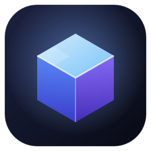
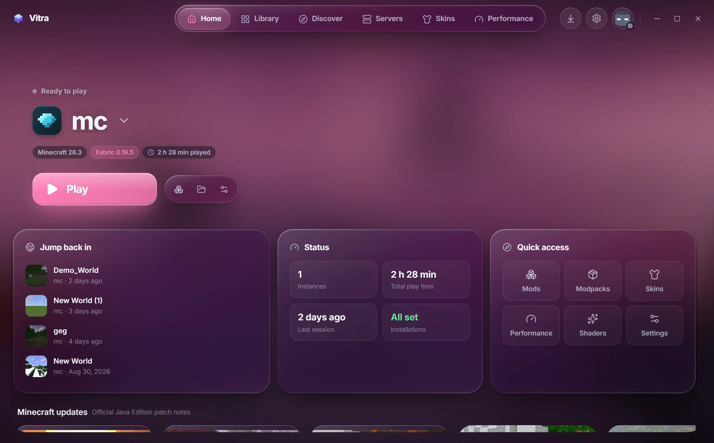
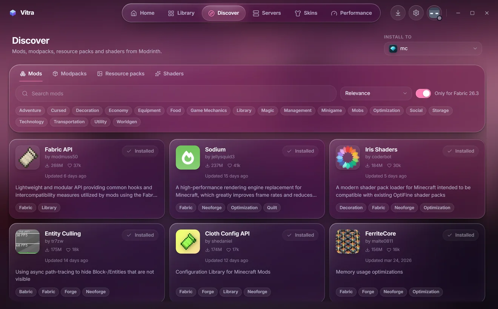
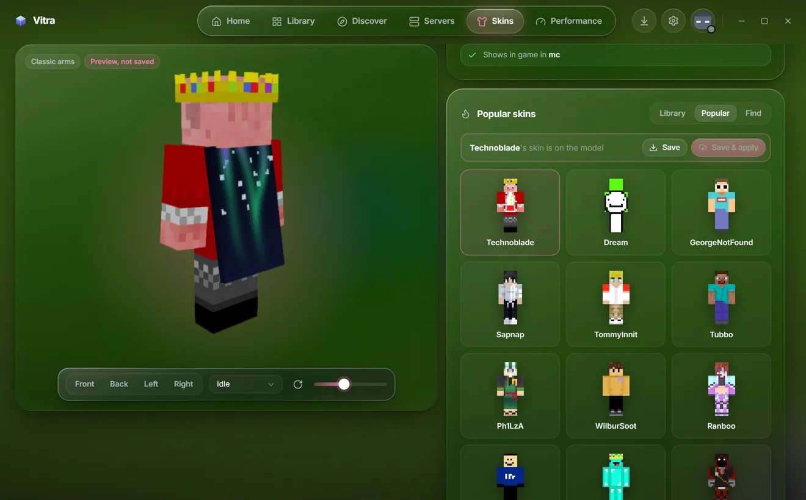
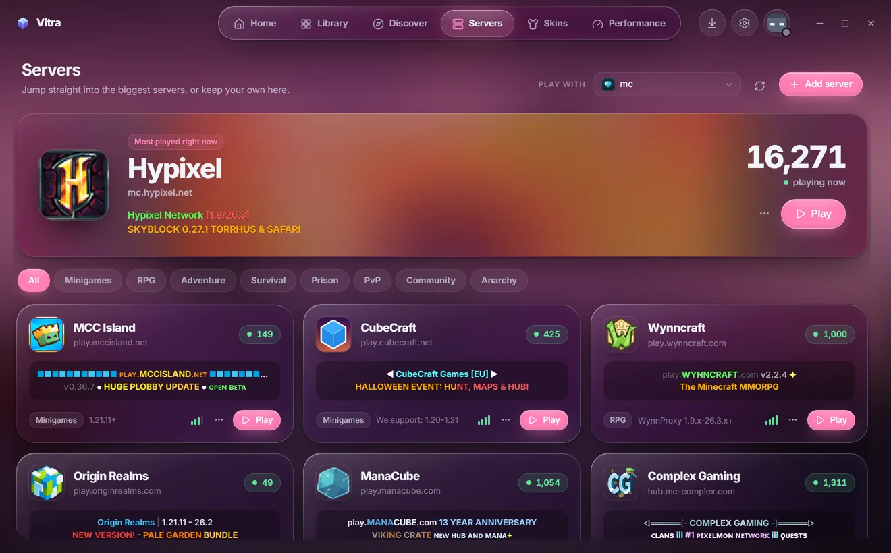
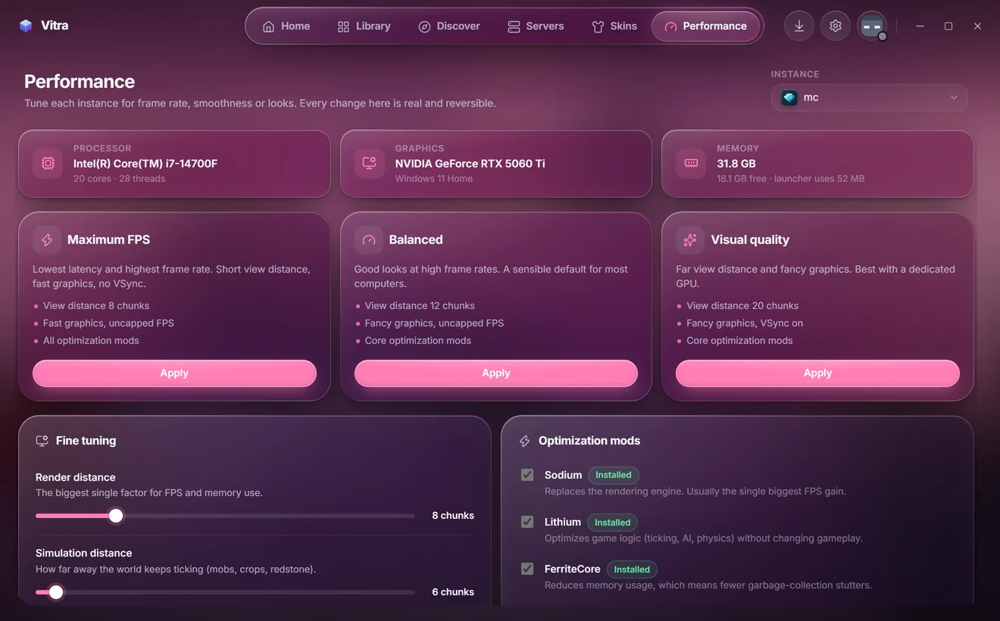

<p align="center">
  
</p>

<h1 align="center">Vitra</h1>

<p align="center">
  <b>A fast, liquid-glass launcher for Minecraft: Java Edition.</b><br>
  Every mod loader, Modrinth built in, live server status, performance presets, 3D skins and free animated capes.
</p>

<p align="center">
  <a href="https://xan.gripe/vitra/"></a>
  
  
  
  
  
</p>

<p align="center">
  
</p>

<table>
  <tr>
    <td width="50%"></td>
    <td width="50%"></td>
  </tr>
  <tr>
    <td align="center"><b>Discover</b>: Modrinth mods, modpacks, packs and shaders, filtered to your instance</td>
    <td align="center"><b>Skins</b>: popular skins in 3D, free animated capes, name changes</td>
  </tr>
  <tr>
    <td width="50%"></td>
    <td width="50%"></td>
  </tr>
  <tr>
    <td align="center"><b>Servers</b>: live status, colored MOTDs, one-click join</td>
    <td align="center"><b>Performance</b>: tuned presets and optimization mods per instance</td>
  </tr>
</table>

> Not an official Minecraft product. Not approved by or associated with Mojang or Microsoft.

## Highlights

- **Every loader.** Vanilla, Fabric, Quilt, Forge and NeoForge, each instance with its own mods, settings and worlds.
- **Modrinth built in.** Search, one-click installs with dependencies resolved, update checks, a restorable trash.
- **Honest and safe.** Every file is checked against published hashes; progress bars measure real bytes.
- **Light on your PC.** A 5 MB installer, and the launcher stops animating while the game runs.
- **Skins, capes and names.** 3D viewer, popular skins, free animated Vitra capes (GIFs too), and name changes with
  close free names suggested when yours is taken.
- **Vitra badge.** Players using Vitra see a badge next to each other's names, and each other's capes, in game.
- **Memories.** A picture of your big moments, like the first diamonds or beating the Ender Dragon, kept automatically
  as a timeline. Works in every version and modpack, in any game language, with nothing running inside the game.

## Status

What works today (verified end to end on Windows 11 by installing and launching real games):

| Area | State |
| --- | --- |
| Vanilla install & launch | ✅ Version manifest, client jar, libraries, natives, assets (5,200+ files, SHA-1 verified), logging config, Quick Play into worlds (1.20+) |
| Java | ✅ Mojang's official runtimes per version (Java 8/17/21/25), downloaded & verified per file; system Java detection; custom Java per instance |
| Fabric / Quilt | ✅ Loader profiles from the official meta APIs. Verified: Fabric 0.19.5 on 26.3 with Sodium + Iris + Lithium (Quilt uses the same code path, not separately launched yet) |
| Forge / NeoForge | ✅ Runs the official installer's processors (client side) and verifies their output hashes. Verified: NeoForge 26.3.0.43-beta, Forge 52.1.0 (1.21.1) and Forge 47.4.10 (1.20.1) reach the title screen |
| Modrinth | ✅ Search, filters, categories, project pages (safe Markdown), version lists, one-click install, required-dependency resolution, incompatibility warnings, update checks, enable/disable, remove → restorable trash |
| Modpacks | ✅ `.mrpack` install from Modrinth, import from file, export (Modrinth files referenced, others bundled). Import/export not yet tested with a large pack |
| Resource packs / shaders | ✅ Pack icons & descriptions, enable + drag-to-reorder (writes `options.txt`), version-compatibility check, Iris shader selection |
| Accounts | ✅ Microsoft device-code sign-in → Xbox Live → XSTS → Minecraft; tokens encrypted with a key held in the OS credential store. Uses Vitra's built-in Azure app, approved by Mojang. Verified with a real account: sign-in, signed-in launch, Quick Play into Hypixel |
| Skins & capes | ✅ 3D viewer (rotate, zoom, views, slim/classic, animations, elytra preview), skin library, **Popular** skins (well-known players, live from Mojang), **Find** any player's skin by name or link, upload to account, Mojang cape selection, OptiFine cape preview + signed-in editor link + in-game check (Capes mod) |
| Name changes | ✅ Checks names with Mojang, suggests the closest free ones when a name is taken, explains the 30-day limit and changes it in one click. Screens tested with stand-in data; the live Mojang calls need a signed-in account |
| Vitra cosmetics | ✅ Free capes (five animated presets, or any picture/GIF turned into a cape with matching elytra) and a Vitra badge (animated for the owner) shown in game to other Vitra players. Fabric 26.3; the mod ships inside Vitra and is added at launch, so mods folders stay untouched. Players can delete their data from Settings |
| Discord status | ✅ Built-in Rich Presence (no plugin): Vitra version, in the launcher / main menu / singleplayer / on a server with its name and live player count, and a "Get Vitra" button. Follows the game through its log; clears when turned off or when Vitra closes |
| Memories | ✅ Reads advancement announcements from the game log (formats and titles from the game's own translations, so any language), keeps hand-picked milestones, every challenge and optionally every advancement, and takes a picture of the game window (Windows Graphics Capture, client area only) as the toast appears. Timeline page with filters, search, favorites, viewer, delete. Verified on 26.3 (English and German) with injected log lines; a minimized game gets a memory without a picture. In Fabric 26.3 the Vitra mod (added for Memories even with badges and capes off, then offline) reports every finished advancement with its id (also where servers hide announcements), first-ever biome visits from the game's own Adventuring Time / Hot Tourist Destinations progress, rare mobs in sight (first sighting per world kept by Vitra), and the exact spot for each. Verified in a real 26.3 demo world: biome firsts with coordinates and pictures |
| Performance | ✅ Hardware detection, 3 presets (writes real `options.txt` values + installs optimization mods + GC preset), optimization-mod picker, render/simulation distance, FPS cap, VSync, memory recommendations |
| Instances | ✅ Create, duplicate, back up (zip), delete, rename, icons, cover pictures from your screenshots, per-instance Java/memory/JVM args/window size/game folder, repair (full re-verify) |
| Import | ✅ Prism Launcher / PolyMC / MultiMC, CurseForge, Modrinth App, ATLauncher, GDLauncher and the official launcher, plus any plain `.minecraft` folder (auto-detected or pick a folder): version, loader, memory, play time, then a verified copy of mods, config, packs, shaders and worlds. The source is never modified |
| Servers | ✅ Curated list of large servers plus your own; live status over the vanilla Server List Ping (SRV lookup, MOTD with colors, favicon, players, version, latency); hide/unhide, edit, remove; one-click join via Quick Play (1.20+) or `--server` on older versions |
| Logs | ✅ Live console (parsed Log4j XML), log & crash-report viewer, crash dialog with plain-language diagnosis |
| Updates | ✅ Signed auto-updates (Tauri updater) served from xan.gripe |
| UI | ✅ Top navigation pill, liquid-glass surfaces with light-catching rims, your player in 3D on the home screen, dark/light/system themes, accent colors (contrast-safe) or "match background", glass intensity/blur/transparency, backgrounds (liquid: your latest screenshot melted into color, aurora, title-screen panorama, latest screenshot, custom image), reduced motion, UI scale |

Measured on the release build (Windows 11, i7-14700F, RTX 5060 Ti):

| Metric | Result |
| --- | --- |
| Installer | 5.2 MB (NSIS, includes the Vitra Cosmetics mod) |
| Rust backend memory | ~10 MB private |
| Whole app incl. WebView2 | ~280–310 MB private, most of it the GPU compositor for the glass blur |
| CPU, window focused with animated background | ~9 % of one core (background drift throttled to ~10 updates/s) |
| CPU, unfocused / idle 60 s / minimized / game running | ~0 % (ambient motion and the 3D player pause) |
| Vanilla 26.3 first install | 105 MB Java 25 runtime + 613 MB game files (5,223 files), ≈ 90 s on this connection |

Not done yet:

- **CurseForge** (needs a CurseForge API key and per-mod distribution permissions). CurseForge `.zip` packs are detected and explained, not installed.
- **macOS/Linux** builds. The cross-platform code paths exist, but a few features (GPU detection, launcher import, system Java search) are Windows-only and nothing has been tested on a Mac.
- In-game FPS overlay (use <kbd>F3</kbd>; Vitra doesn't show invented numbers) and automated FPS benchmarking.
- Vitra cosmetics for Minecraft versions other than 26.3 (each needs its own build of the mod).

## Repository layout

```
src/                     React UI (no direct filesystem/network access)
  lib/api.ts             typed wrappers for every backend command (the whole IPC surface)
  lib/store.ts           zustand stores: settings, nav, instances, tasks, accounts, logs, toasts, dialogs
  lib/events.ts          backend events → stores (task progress, game logs, exits, auth)
  styles/tokens.css      design tokens: color, glass, radius, motion, type (dark + light)
  components/ui/         design-system primitives (Button, Select, Slider, Modal, Tabs, …)
  features/<page>/       Home, Library, Instance, Memories, Discover, Servers, Skins, Performance, Settings, Boot
src-tauri/src/           Rust backend
  net.rs                 parallel downloader: retries, resume (HTTP Range), SHA-1 verification
  tasks.rs               progress reporting (atomic counters, throttled events, honest progress)
  minecraft/             manifest + rules, install, Fabric/Quilt, Forge/NeoForge processors, launch
  java.rs                Mojang runtimes + system Java detection
  auth.rs                Microsoft/Xbox/Minecraft auth, encrypted token storage
  modrinth.rs content.rs Modrinth API, install plans, content index, updates, trash
  modpack.rs packs.rs    .mrpack import/export; resource packs, shaders, options.txt
  skins.rs               skins, capes and name changes (Mojang profile API)
  cosmetics.rs           Vitra badges and capes: ownership proof, game token, launch arguments, data deletion
  presence.rs discord.rs Discord Rich Presence: what to show, and a small client for Discord's local IPC
  memories.rs capture.rs Memories: advancements from the game log, pictures of the game window, storage
  system.rs              system info, news, panorama, logs, storage
mods/vitra-cosmetics/    the Fabric mod that draws badges and capes in game (plain javac, no Gradle)
services/vitra-api/      api.xan.gripe: Cloudflare Worker + D1 for cosmetics (who uses Vitra, capes)
site/                    the xan.gripe pages: /vitra/ (download, privacy, terms) and /k3/
scripts/                 release manifest, cosmetics mod build, cape art, site preview
```

## Development

Requirements: Node 20+, Rust (stable), and on Windows the MSVC build tools + Windows SDK.

```bash
npm install
npm run tauri dev      # run the app with hot reload
npm run tauri build    # release build + NSIS installer in src-tauri/target/release/bundle
```

Checks:

```bash
npm run typecheck              # TypeScript
cd src-tauri && cargo test     # Rust unit tests (rules, args, log parsing, path safety, …)
```

The cosmetics mod is prebuilt at `src-tauri/resources/mods/`. To rebuild it you need a JDK 25 and Minecraft 26.3
with Fabric installed once through Vitra: `python scripts/build-cosmetics-mod.py`. The script finds Vitra's game data
folder by itself; if you moved it in Settings, point `VITRA_DATA` at it.

Windows note: if the project lives in a very deep folder, the MSVC linker can hit the 260-character path limit.
Set `CARGO_TARGET_DIR` to a short path (e.g. `C:\vt`) if you see `LNK1104`.

### Releasing

1. Bump the version in `package.json`, `src-tauri/Cargo.toml` and `src-tauri/tauri.conf.json`.
2. Build with the updater signing key set (`TAURI_SIGNING_PRIVATE_KEY`); the key itself never goes in the repo.
3. `node scripts/update-manifest.mjs <notes.txt> <site>/vitra/updates/latest.json` writes the update manifest.
4. Publish the installer, `latest.json` and the updated `site/` pages to xan.gripe. Installed copies update themselves.

## Microsoft sign-in setup

Minecraft's authentication API only accepts Azure applications that Mojang has approved. Vitra ships with its
own app built in (`builtin_client_id` in `src-tauri/src/auth.rs`, masked so it isn't a plain string in the
binary; a client ID isn't a secret), so players just click **Sign in**.

To use your own app instead (for development):

1. In the [Azure portal](https://portal.azure.com/#view/Microsoft_AAD_RegisteredApps/ApplicationsListBlade),
   register an application for **personal Microsoft accounts** and enable **Allow public client flows**.
2. Request Minecraft API access for its Application ID via Mojang's app review form (<https://aka.ms/mce-reviewappid>).
3. Paste the Application (client) ID in **Settings → Accounts → Advanced**.

Without an account you can still create instances, install mods and launch the official **demo**.

## Design principles

- **Honest progress.** Progress bars are byte- or file-accurate; when nothing can be measured the UI shows an
  indeterminate animation instead of a made-up percentage.
- **Security.** Downloads are verified against published hashes; modpack paths are checked for traversal and
  hosts are restricted to the `.mrpack` allow-list; remote HTML/Markdown is never injected (rendered as React
  elements, images limited to Modrinth's CDN by CSP); only `https` links open externally; the app never runs
  downloaded executables other than the Mojang Java runtime and Forge's own installer processors. The Minecraft
  access token only ever goes to Microsoft and Mojang; Vitra's own service gets a signature, never the token.
- **Performance.** Only top-level surfaces use `backdrop-filter`; ambient animation and the 3D player pause while
  the game runs or the window is hidden; heavy code (the three.js skin viewer) loads on demand.
- **Never all the RAM.** Memory defaults to a recommendation (≤ half of physical memory) and is validated.
